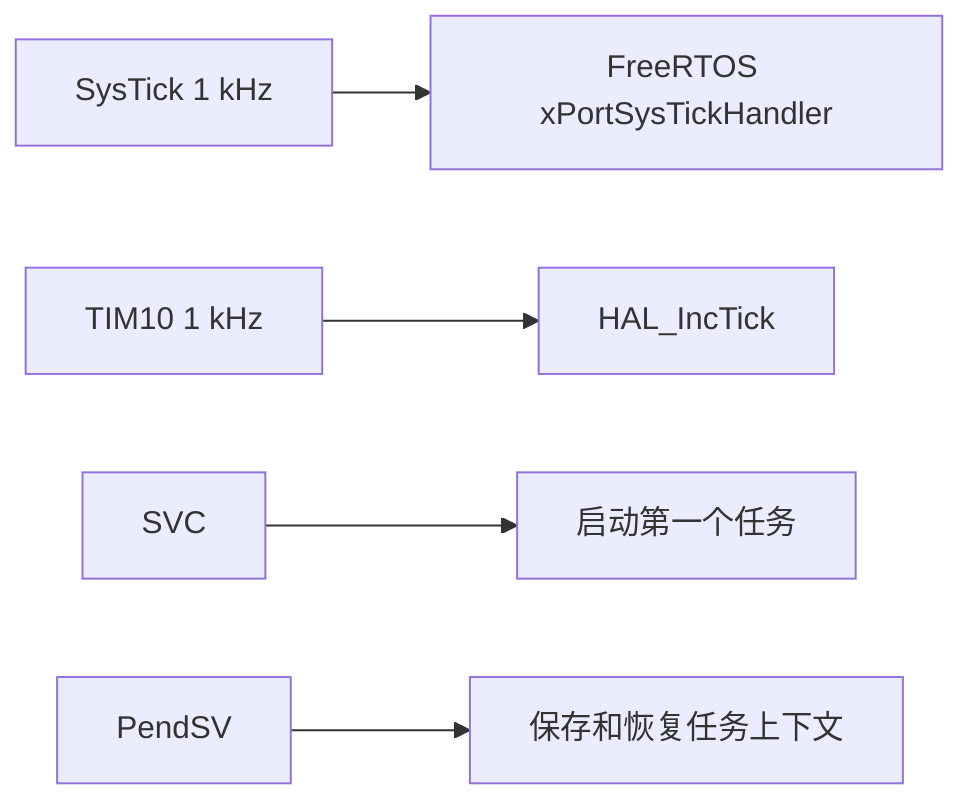

# Day 5：FreeRTOS Kernel V11.3.0 手动移植指导手册

日期：2026-09-12  
适用工程：`project/my_project`  
目标芯片：STM32F411CEU6 / Cortex-M4F  
编译器：Arm GNU Toolchain 15.2.Rel1  
应用地址：`0x0800C000`  
HAL 时基：TIM10 1 kHz  
FreeRTOS 时基：SysTick 1 kHz

## 1. 本日边界与完成定义

Day 4 已由开发者完成 GPIO、TIM3 PWM、RTC 和 UART 基本实机验证。由于进度调整，以下项目继续保留为延期项，不能写成 PASS：

- ADC 电池采样和绝对误差。
- SPI1 阻塞/DMA 实测。
- UART DMA + IDLE 完整收帧闭环。
- PA2 充电状态、供电自锁和低功耗测试。
- 部分 EXTI 主动触发测试。

Day 5 只完成 FreeRTOS Kernel 的独立最小移植，不接入旧工程业务任务，不使用 CMSIS-RTOS/CMSIS-RTOS2。

满足以下条件才算 Day 5 通过：

1. 官方 FreeRTOS-Kernel 固定在 `V11.3.0`。
2. 仅编译计划列出的 Kernel、ARM_CM4F Port 和 `heap_4.c`。
3. 工程不存在 `cmsis_os.h`、`cmsis_os2.h` 或 `cmsis_os2.c` 依赖。
4. SVC、PendSV 和 SysTick 都由 FreeRTOS Port 提供，链接结果中每个 Handler 只有一份定义。
5. HAL Tick 继续来自 TIM10；SysTick 只服务 FreeRTOS。
6. 两个任务能表现出阻塞和高优先级抢占。
7. Idle、Tick、Stack Overflow 和 Malloc Failed Hook 已实现。
8. Stack Overflow、Malloc Failed、错误 IRQ 优先级三项故障注入分别验证。
9. Debug 和 Release 均能从空缓存构建。
10. 保存 GDB 数值和 GPIO 波形，随后才创建 `v0.5.0-freertos-kernel` Tag。

## 2. 先隔离 Day 4 工作

当前工作区同时存在已暂存和未暂存的 Day 4 修改。开始前执行：

```powershell
git status --short
git diff
git diff --cached
git diff --check
```

处理原则：

- PWM 驱动和已经验证的 GPIO/RTC/UART TX 代码可以形成 Day 4 检查点。
- `rtc_view.png`、`rtc_view2.png` 和 `const_ptr.png` 不应散落在仓库根目录；需要长期保存时放到文档资源目录，否则放到已忽略的 `Docs/evidence/day04/`。
- `.vscode/c_cpp_properties.json` 不要固定为 MinGW x64 编译器。嵌入式工程应由 CMake Tools 提供编译数据库和 Cortex-M4F 参数。
- 开始 RTOS 前移除 `while (1)` 中的阻塞 UART 测试和 `HAL_Delay()` 测试代码。

当前 UART IDLE 代码只检查 IDLE 标志并再次调用 `HAL_UART_Receive_DMA()`。普通 DMA 接收仍处于 `HAL_UART_STATE_BUSY_RX` 时，再次调用通常会返回 `HAL_BUSY`，而且当前代码没有计算实际接收长度。因此它只能作为 UART TX/DMA 冒烟记录，不能作为 DMA+IDLE 通过证据。完整修复留到 Day 6，届时使用 `HAL_UARTEx_ReceiveToIdle_DMA()` 和 `HAL_UARTEx_RxEventCallback()`。

推荐先提交一个不夸大范围的检查点：

```powershell
git add -p
git commit -m "test(hal): record gpio pwm rtc and uart bring-up"
```

不要在该提交说明中写 SPI、ADC 或 UART DMA+IDLE 已通过。

## 3. 获取并固定官方 Kernel

推荐使用 Git submodule：

```powershell
git submodule add https://github.com/FreeRTOS/FreeRTOS-Kernel.git project/my_project/Middlewares/FreeRTOS-Kernel
git -C project/my_project/Middlewares/FreeRTOS-Kernel checkout V11.3.0
git -C project/my_project/Middlewares/FreeRTOS-Kernel describe --tags --exact-match
git -C project/my_project/Middlewares/FreeRTOS-Kernel rev-parse HEAD
git submodule status
```

预期 `describe` 输出：

```text
V11.3.0
```

仓库最终依靠 gitlink 固定具体提交，不设置跟随 `main`。即使官方已经出现新版本，本阶段也不升级。

如果使用 ZIP，则必须保留完整官方源码、`LICENSE.md`，并在 `Docs/third_party.md` 记录版本、来源、下载日期、SHA-256 和本地修改。两种方式只选择一种。

## 4. 建立目录

在 `project/my_project` 下建立：

```text
project/my_project/
├─ App/
│  └─ Tasks/
│     ├─ day05_rtos_demo.c
│     └─ day05_rtos_demo.h
├─ Config/
│  └─ FreeRTOSConfig.h
├─ Middlewares/
│  └─ FreeRTOS-Kernel/       # 官方 V11.3.0 submodule
└─ cmake/
   └─ freertos_kernel.cmake
```

不要从旧工程复制 CubeMX 生成的 `freertos.c`、`cmsis_os.c`、`cmsis_os2.c` 或旧版 `FreeRTOSConfig.h`。

## 5. 明确需要编译的 Kernel 文件

本日加入：

```text
Middlewares/FreeRTOS-Kernel/tasks.c
Middlewares/FreeRTOS-Kernel/queue.c
Middlewares/FreeRTOS-Kernel/list.c
Middlewares/FreeRTOS-Kernel/timers.c
Middlewares/FreeRTOS-Kernel/event_groups.c
Middlewares/FreeRTOS-Kernel/stream_buffer.c
Middlewares/FreeRTOS-Kernel/portable/GCC/ARM_CM4F/port.c
Middlewares/FreeRTOS-Kernel/portable/MemMang/heap_4.c
```

包含目录：

```text
Config
Middlewares/FreeRTOS-Kernel/include
Middlewares/FreeRTOS-Kernel/portable/GCC/ARM_CM4F
```

`croutine.c`、MPU Port、其他编译器 Port 和 CMSIS wrapper 均不加入。

## 6. 添加 CMake 集成

创建 `project/my_project/cmake/freertos_kernel.cmake`：

```cmake
set(FREERTOS_KERNEL_DIR
    "${CMAKE_CURRENT_SOURCE_DIR}/Middlewares/FreeRTOS-Kernel"
)

set(FREERTOS_REQUIRED_FILES
    tasks.c
    queue.c
    list.c
    timers.c
    event_groups.c
    stream_buffer.c
    include/FreeRTOS.h
    portable/GCC/ARM_CM4F/port.c
    portable/GCC/ARM_CM4F/portmacro.h
    portable/MemMang/heap_4.c
)

foreach(FILE_PATH IN LISTS FREERTOS_REQUIRED_FILES)
    if(NOT EXISTS "${FREERTOS_KERNEL_DIR}/${FILE_PATH}")
        message(FATAL_ERROR "FreeRTOS V11.3.0 file missing: ${FILE_PATH}")
    endif()
endforeach()

add_library(freertos_kernel STATIC
    ${FREERTOS_KERNEL_DIR}/tasks.c
    ${FREERTOS_KERNEL_DIR}/queue.c
    ${FREERTOS_KERNEL_DIR}/list.c
    ${FREERTOS_KERNEL_DIR}/timers.c
    ${FREERTOS_KERNEL_DIR}/event_groups.c
    ${FREERTOS_KERNEL_DIR}/stream_buffer.c
    ${FREERTOS_KERNEL_DIR}/portable/GCC/ARM_CM4F/port.c
    ${FREERTOS_KERNEL_DIR}/portable/MemMang/heap_4.c
)

target_include_directories(freertos_kernel PUBLIC
    ${CMAKE_CURRENT_SOURCE_DIR}/Config
    ${FREERTOS_KERNEL_DIR}/include
    ${FREERTOS_KERNEL_DIR}/portable/GCC/ARM_CM4F
)

target_link_libraries(freertos_kernel PUBLIC stm32cubemx)

target_sources(${CMAKE_PROJECT_NAME} PRIVATE
    ${CMAKE_CURRENT_SOURCE_DIR}/App/Tasks/day05_rtos_demo.c
)

target_include_directories(${CMAKE_PROJECT_NAME} PRIVATE
    ${CMAKE_CURRENT_SOURCE_DIR}/App/Tasks
)

target_compile_definitions(${CMAKE_PROJECT_NAME} PRIVATE APP_USE_FREERTOS=1)
target_link_libraries(${CMAKE_PROJECT_NAME} PRIVATE freertos_kernel)
```

在顶层 `project/my_project/CMakeLists.txt` 的 `add_subdirectory(cmake/stm32cubemx)` 之后加入：

```cmake
include(cmake/freertos_kernel.cmake)
```

原因是 `freertos_kernel` 需要复用 `stm32cubemx` 提供的 STM32 CMSIS/HAL 头文件路径和 `STM32F411xE` 定义。

## 7. 手写 FreeRTOSConfig.h

创建 `project/my_project/Config/FreeRTOSConfig.h`：

```c
#ifndef FREERTOS_CONFIG_H
#define FREERTOS_CONFIG_H

#include <stddef.h>
#include <stdint.h>
#include "stm32f4xx.h"

#define configUSE_PREEMPTION                    1
#define configUSE_TIME_SLICING                  1
#define configUSE_PORT_OPTIMISED_TASK_SELECTION 1
#define configUSE_TICKLESS_IDLE                 0

#define configCPU_CLOCK_HZ                      (100000000UL)
#define configTICK_RATE_HZ                      ((TickType_t)1000U)
#define configMAX_PRIORITIES                    8
#define configMINIMAL_STACK_SIZE                ((uint16_t)128U)
#define configMAX_TASK_NAME_LEN                 16
#define configUSE_16_BIT_TICKS                  0
#define configIDLE_SHOULD_YIELD                 1

#define configSUPPORT_STATIC_ALLOCATION         0
#define configSUPPORT_DYNAMIC_ALLOCATION        1
#define configTOTAL_HEAP_SIZE                   ((size_t)(24U * 1024U))
#define configAPPLICATION_ALLOCATED_HEAP        0

#define configUSE_IDLE_HOOK                     1
#define configUSE_TICK_HOOK                     1
#define configUSE_MALLOC_FAILED_HOOK            1
#define configCHECK_FOR_STACK_OVERFLOW          2

#define configUSE_MUTEXES                       1
#define configUSE_RECURSIVE_MUTEXES             0
#define configUSE_COUNTING_SEMAPHORES           1
#define configUSE_QUEUE_SETS                    0
#define configUSE_TASK_NOTIFICATIONS            1
#define configTASK_NOTIFICATION_ARRAY_ENTRIES   1
#define configQUEUE_REGISTRY_SIZE               8

#define configUSE_TIMERS                        1
#define configTIMER_TASK_PRIORITY               2
#define configTIMER_QUEUE_LENGTH                10
#define configTIMER_TASK_STACK_DEPTH            256

#define configUSE_TRACE_FACILITY                1
#define configUSE_STATS_FORMATTING_FUNCTIONS    0
#define configGENERATE_RUN_TIME_STATS           0
#define configUSE_CO_ROUTINES                   0
#define configMAX_CO_ROUTINE_PRIORITIES          1

#define INCLUDE_vTaskPrioritySet                1
#define INCLUDE_uxTaskPriorityGet               1
#define INCLUDE_vTaskDelete                     1
#define INCLUDE_vTaskSuspend                    1
#define INCLUDE_vTaskDelay                      1
#define INCLUDE_xTaskDelayUntil                 1
#define INCLUDE_vTaskDelayUntil                 1
#define INCLUDE_xTaskGetSchedulerState          1
#define INCLUDE_uxTaskGetStackHighWaterMark     1
#define INCLUDE_uxTaskGetStackHighWaterMark2    1
#define INCLUDE_xTaskGetCurrentTaskHandle       1
#define INCLUDE_eTaskGetState                   1
#define INCLUDE_xTimerPendFunctionCall          1

#define configPRIO_BITS __NVIC_PRIO_BITS
#define configLIBRARY_LOWEST_INTERRUPT_PRIORITY 15
#define configLIBRARY_MAX_SYSCALL_INTERRUPT_PRIORITY 5

#define configKERNEL_INTERRUPT_PRIORITY \
    (configLIBRARY_LOWEST_INTERRUPT_PRIORITY << (8U - configPRIO_BITS))

#define configMAX_SYSCALL_INTERRUPT_PRIORITY \
    (configLIBRARY_MAX_SYSCALL_INTERRUPT_PRIORITY << (8U - configPRIO_BITS))

extern void vDay05AssertFailed(const char *file, int line);

#define configASSERT(CONDITION)                         \
    do                                                  \
    {                                                   \
        if ((CONDITION) == 0)                           \
        {                                               \
            vDay05AssertFailed(__FILE__, __LINE__);     \
        }                                               \
    } while (0)

#define vPortSVCHandler     SVC_Handler
#define xPortPendSVHandler  PendSV_Handler
#define xPortSysTickHandler SysTick_Handler

#endif
```

关键点：

- `configMAX_PRIORITIES=8` 时，任务优先级合法范围为 0～7。
- `configUSE_PORT_OPTIMISED_TASK_SELECTION=1` 要求最大优先级不超过 32，本配置满足。
- Cortex-M 数值越小，中断紧急程度越高。
- 调用 `...FromISR()` 的中断，其抢占优先级数值必须大于或等于 5。
- TIM10 不调用 FreeRTOS API，可以保持优先级 15。
- `configTOTAL_HEAP_SIZE` 先使用 24 KiB，Day 5 完成后依据最小剩余 Heap 调整。

## 8. 交给 FreeRTOS 的三个异常入口

当前 `Src/stm32f4xx_it.c` 中存在 CubeMX 生成的空函数：

```c
SVC_Handler()
PendSV_Handler()
SysTick_Handler()
```

而 ARM_CM4F `port.c` 通过 `FreeRTOSConfig.h` 中的宏生成同名 Handler。如果两边同时存在，链接会报 multiple definition。

给 `stm32f4xx_it.c` 中这三个空函数分别增加编译保护：

```c
#if !defined(APP_USE_FREERTOS)
void SVC_Handler(void)
{
}
#endif
```

PendSV 和 SysTick 同样处理。不要给 FreeRTOS 的 SVC/PendSV 再包一层普通 C 函数；它们涉及裸函数和任务上下文栈。

保持以下关系：



确认 `TIM1_UP_TIM10_IRQHandler()` 仍然调用 `HAL_TIM_IRQHandler(&htim10)`，并且 `HAL_TIM_PeriodElapsedCallback()` 只在 `htim->Instance == TIM10` 时调用 `HAL_IncTick()`。

## 9. 建立两个最小任务

创建 `App/Tasks/day05_rtos_demo.h`：

```c
#ifndef DAY05_RTOS_DEMO_H
#define DAY05_RTOS_DEMO_H

#include <stdint.h>

typedef enum
{
    DAY05_FAILURE_NONE = 0,
    DAY05_FAILURE_LOW_TASK_CREATE,
    DAY05_FAILURE_HIGH_TASK_CREATE,
    DAY05_FAILURE_SCHEDULER_RETURNED,
    DAY05_FAILURE_STACK_OVERFLOW,
    DAY05_FAILURE_MALLOC,
    DAY05_FAILURE_ASSERT
} Day05Failure;

typedef struct
{
    volatile uint32_t low_period_count;
    volatile uint32_t low_busy_count;
    volatile uint32_t high_period_count;
    volatile uint32_t idle_hook_count;
    volatile uint32_t tick_hook_count;
    volatile uint32_t low_stack_min_words;
    volatile uint32_t high_stack_min_words;
    volatile uint32_t free_heap_bytes;
    volatile uint32_t minimum_ever_free_heap_bytes;
    volatile uint32_t assert_line;
    volatile Day05Failure failure;
    const char *volatile assert_file;
} Day05RtosStats;

extern Day05RtosStats g_day05_rtos_stats;

void Day05Rtos_Start(void);

#endif
```

创建 `App/Tasks/day05_rtos_demo.c`：

```c
#include "day05_rtos_demo.h"

#include "FreeRTOS.h"
#include "task.h"

#include "main.h"

#define LOW_TASK_STACK_WORDS  256U
#define HIGH_TASK_STACK_WORDS 256U

#define LOW_TASK_PRIORITY  (tskIDLE_PRIORITY + 1U)
#define HIGH_TASK_PRIORITY (tskIDLE_PRIORITY + 3U)

Day05RtosStats g_day05_rtos_stats = {0};

static TaskHandle_t low_task_handle;
static TaskHandle_t high_task_handle;

static void LowPriorityTask(void *argument);
static void HighPriorityTask(void *argument);
static void Day05Fail(Day05Failure failure);

void Day05Rtos_Start(void)
{
    BaseType_t result;

    result = xTaskCreate(LowPriorityTask,
                         "rtos-low",
                         LOW_TASK_STACK_WORDS,
                         NULL,
                         LOW_TASK_PRIORITY,
                         &low_task_handle);
    if (result != pdPASS)
    {
        Day05Fail(DAY05_FAILURE_LOW_TASK_CREATE);
    }

    result = xTaskCreate(HighPriorityTask,
                         "rtos-high",
                         HIGH_TASK_STACK_WORDS,
                         NULL,
                         HIGH_TASK_PRIORITY,
                         &high_task_handle);
    if (result != pdPASS)
    {
        Day05Fail(DAY05_FAILURE_HIGH_TASK_CREATE);
    }

    g_day05_rtos_stats.free_heap_bytes = (uint32_t)xPortGetFreeHeapSize();
    g_day05_rtos_stats.minimum_ever_free_heap_bytes =
        (uint32_t)xPortGetMinimumEverFreeHeapSize();

    vTaskStartScheduler();
    Day05Fail(DAY05_FAILURE_SCHEDULER_RETURNED);
}

static void LowPriorityTask(void *argument)
{
    TickType_t last_wake_time = xTaskGetTickCount();
    (void)argument;

    for (;;)
    {
        uint32_t start_ms;

        g_day05_rtos_stats.low_period_count++;
        HAL_GPIO_WritePin(LED_EN_GPIO_Port, LED_EN_Pin, GPIO_PIN_SET);

        start_ms = HAL_GetTick();
        while ((HAL_GetTick() - start_ms) < 20U)
        {
            g_day05_rtos_stats.low_busy_count++;
        }

        HAL_GPIO_WritePin(LED_EN_GPIO_Port, LED_EN_Pin, GPIO_PIN_RESET);

        g_day05_rtos_stats.low_stack_min_words =
            (uint32_t)uxTaskGetStackHighWaterMark(NULL);
        g_day05_rtos_stats.free_heap_bytes =
            (uint32_t)xPortGetFreeHeapSize();
        g_day05_rtos_stats.minimum_ever_free_heap_bytes =
            (uint32_t)xPortGetMinimumEverFreeHeapSize();

        vTaskDelayUntil(&last_wake_time, pdMS_TO_TICKS(200U));
    }
}

static void HighPriorityTask(void *argument)
{
    TickType_t last_wake_time = xTaskGetTickCount();
    (void)argument;

    for (;;)
    {
        g_day05_rtos_stats.high_period_count++;
        HAL_GPIO_TogglePin(WDI_GPIO_Port, WDI_Pin);
        g_day05_rtos_stats.high_stack_min_words =
            (uint32_t)uxTaskGetStackHighWaterMark(NULL);

        vTaskDelayUntil(&last_wake_time, pdMS_TO_TICKS(5U));
    }
}

void vApplicationIdleHook(void)
{
    g_day05_rtos_stats.idle_hook_count++;
}

void vApplicationTickHook(void)
{
    g_day05_rtos_stats.tick_hook_count++;
}

void vApplicationStackOverflowHook(TaskHandle_t task, char *task_name)
{
    (void)task;
    (void)task_name;
    Day05Fail(DAY05_FAILURE_STACK_OVERFLOW);
}

void vApplicationMallocFailedHook(void)
{
    Day05Fail(DAY05_FAILURE_MALLOC);
}

void vDay05AssertFailed(const char *file, int line)
{
    g_day05_rtos_stats.assert_file = file;
    g_day05_rtos_stats.assert_line = (uint32_t)line;
    Day05Fail(DAY05_FAILURE_ASSERT);
}

static void Day05Fail(Day05Failure failure)
{
    g_day05_rtos_stats.failure = failure;
    taskDISABLE_INTERRUPTS();

    for (;;)
    {
        __NOP();
    }
}
```

测试信号含义：

| 信号 | 预期 |
|---|---|
| PB15 `LED_EN` | 每 200 ms 拉高约 20 ms |
| PB2 `WDI` | 每 5 ms 翻转一次，完整方波周期约 10 ms |
| 高优先级抢占 | PB15 高电平的 20 ms 忙循环期间，PB2 仍持续翻转 |
| 阻塞 | 两个任务都通过 `vTaskDelayUntil()` 进入 Blocked 状态 |

PB1 `WDOG_EN_N` 必须保持高电平。PB2 仅在外部看门狗已禁用时作为测试波形使用。

## 10. 在 main() 启动调度器

在 `Src/main.c` 的 USER CODE Include 区加入：

```c
#include "day05_rtos_demo.h"
```

保留现有初始化顺序。在全部 `MX_*_Init()` 完成后：

```c
__enable_irq();
HAL_GPIO_WritePin(WDOG_EN_N_GPIO_Port, WDOG_EN_N_Pin, GPIO_PIN_SET);
Day05Rtos_Start();
Error_Handler();
```

`Day05Rtos_Start()` 正常情况下不会返回。删除或禁用其后的 Day 4 UART/PWM 循环测试，避免把阻塞式诊断误认为 RTOS 任务。

Bootloader 在跳转前执行了 `__disable_irq()`，所以应用必须恢复全局中断。当前恢复位置在全部初始化之后，功能上已经能够启动；但初始化期间 HAL Tick 不增长。如果 LSE 启动失败，依赖 `HAL_GetTick()` 的超时可能无法退出。后续应把 Bootloader 遗留 NVIC 清理和安全恢复中断整理成独立启动函数。在 Day 5 至少验证：

```text
PRIMASK = 0
PB1 = High
SCB->VTOR = 0x0800C000
```

## 11. 构建

从仓库根目录执行：

```powershell
. .\tools\enter-env.ps1
Set-Location project\my_project
cmake --fresh --preset Debug
cmake --build --preset Debug --clean-first
cmake --fresh --preset Release
cmake --build --preset Release --clean-first
```

预期：

- `tasks.c`、`queue.c`、`list.c`、`timers.c`、`event_groups.c`、`stream_buffer.c` 被编译。
- 只出现一个 `portable/GCC/ARM_CM4F/port.c`。
- 只出现一个 `heap_4.c`。
- ELF、HEX、BIN、MAP 均生成。
- `.isr_vector` 仍位于 `0x0800C000`。

## 12. PC 端静态核验

### 12.1 禁止 CMSIS-RTOS wrapper

```powershell
rg -n "cmsis_os\.h|cmsis_os2\.h|cmsis_os2\.c|osThreadNew|osDelay" . -g "!build/**"
```

在新工程源码中预期无输出。文档中出现名字可以忽略。

### 12.2 核对异常 Handler

```powershell
arm-none-eabi-nm -n build\Debug\my_project.elf | rg "SVC_Handler|PendSV_Handler|SysTick_Handler|TIM1_UP_TIM10_IRQHandler"
```

四个符号应各出现一次。SVC、PendSV、SysTick 应来自 ARM_CM4F Port，TIM10 Handler 应来自 `stm32f4xx_it.c`。

### 12.3 核对 Kernel 源文件

```powershell
rg -n "tasks\.c|queue\.c|list\.c|timers\.c|event_groups\.c|stream_buffer\.c|heap_4\.c|ARM_CM4F" build\Debug\build.ninja
```

检查没有混入其他 Port 或 heap 实现。

### 12.4 核对应用布局

```powershell
arm-none-eabi-objdump -h build\Debug\my_project.elf | rg "isr_vector|text|bss"
arm-none-eabi-size build\Debug\my_project.elf
```

记录增加 FreeRTOS 前后的 Flash、Data 和 BSS 变化。

## 13. 上板调度验收

刷入 Debug 固件，停在 `main()` 后继续运行，观察：

```text
g_day05_rtos_stats.failure == DAY05_FAILURE_NONE
g_day05_rtos_stats.tick_hook_count 持续增长
g_day05_rtos_stats.high_period_count 持续增长
g_day05_rtos_stats.low_period_count 持续增长
g_day05_rtos_stats.idle_hook_count 持续增长
```

运行约 10 秒后：

- `tick_hook_count` 应增加约 10,000。
- `high_period_count` 应增加约 2,000。
- `low_period_count` 应增加约 50。
- `HAL_GetTick()` 和 `xTaskGetTickCount()` 都应增加约 10,000，但它们来自不同定时器。
- `free_heap_bytes` 大于 0。
- `minimum_ever_free_heap_bytes` 不应继续无原因下降。
- 两个 `stack_min_words` 大于各自初始栈的 25%。

在 GDB 中检查：

```text
SysTick->LOAD = 99999        # 100 MHz / 1000 - 1
SysTick->CTRL ENABLE = 1
SysTick->CTRL TICKINT = 1
SCB->SHP[10]                 # PendSV 最低优先级
SCB->SHP[11]                 # SysTick 最低优先级
TIM10->PSC = 99
TIM10->ARR = 999
```

使用逻辑分析仪同时采集 PB15 和 PB2。PB15 高电平期间 PB2 仍出现边沿，即可直观看到高优先级任务抢占低优先级忙循环。

## 14. 三项故障注入

每项单独修改、构建、烧录、记录、恢复。不要同时打开多个故障。

### 14.1 Malloc Failed Hook

在调度器启动前临时加入：

```c
void *test = pvPortMalloc(configTOTAL_HEAP_SIZE + 1U);
(void)test;
```

预期进入 `vApplicationMallocFailedHook()`，并看到：

```text
g_day05_rtos_stats.failure == DAY05_FAILURE_MALLOC
```

验证后删除这两行。

### 14.2 Stack Overflow Hook

把一个测试任务栈临时减小到 64 words，并在任务内建立较大的 `volatile` 局部数组，然后主动产生任务切换：

```c
volatile uint8_t stack_test[256];
stack_test[0] = 1U;
taskYIELD();
```

预期进入 `vApplicationStackOverflowHook()`。如果直接 HardFault，说明溢出在内核检查前已经破坏了异常栈；适当调大任务栈或减小数组后重新测试。

验证后恢复 256 words。

### 14.3 错误中断优先级 Assert

选择一个仅用于测试的外部中断，把其优先级临时设为 4，并在 ISR 内调用一个 `...FromISR()` API，例如 `vTaskNotifyGiveFromISR()`。

因为 4 的紧急程度高于允许调用 FreeRTOS API 的边界 5，ARM_CM4F Port 应通过 `configASSERT` 捕获，并进入 `vDay05AssertFailed()`。

验证后：

- 把 IRQ 优先级恢复为 5 或更大的数值。
- 删除故障注入调用。
- 确认正常构建中 `failure == DAY05_FAILURE_NONE`。

## 15. 常见问题定位

### 链接出现 SVC/PendSV/SysTick multiple definition

原因：`stm32f4xx_it.c` 的空 Handler 与 `port.c` 同时参与链接。检查 `APP_USE_FREERTOS` 宏和三个函数的条件编译。

### `vTaskStartScheduler()` 返回

通常是 Idle Task 或 Timer Task 内存分配失败。检查：

- `heap_4.c` 是否参与链接。
- `configTOTAL_HEAP_SIZE` 是否有效。
- 是否同时链接了第二个 heap 实现。
- MAP 中 `ucHeap` 是否存在。

### 调度后 HAL_Delay 不工作

检查 TIM10 中断是否仍然执行 `HAL_IncTick()`，不要在 SysTick Handler 中调用 `HAL_IncTick()`。

### 任务完全不切换

检查：

- `SysTick->CTRL`。
- `SysTick_Handler` 是否来自 FreeRTOS Port。
- PRIMASK 是否为 0。
- PendSV/SysTick 优先级是否为最低 15。
- VTOR 是否为 `0x0800C000`。

### 进入 HardFault

优先记录：

```text
PC / LR / MSP / PSP
CFSR / HFSR / BFAR / MMFAR
当前任务名
当前任务 Stack High Water Mark
```

常见原因是 Handler 重复、VTOR 错误、任务栈过小、Bootloader 遗留中断、在高优先级 ISR 中调用 FreeRTOS API。

### F5 偶发连接失败

继续保留调试器在连接早期把 PB1 `WDOG_EN_N` 拉高的配置。把该问题与 RTOS 调度失败分开：如果还没到 `main()` 就复位，它属于启动/看门狗问题；已经进入任务后复位才检查 RTOS 和栈。

## 16. 证据记录

建议保存：

```text
Docs/evidence/day05/
├─ freertos-version.txt
├─ debug-clean-build.log
├─ release-clean-build.log
├─ handler-symbols.txt
├─ rtos-gdb-values.txt
├─ scheduling-wave.png
├─ malloc-failed-hook.txt
├─ stack-overflow-hook.txt
└─ irq-priority-assert.txt
```

`freertos-version.txt` 至少包含：

```text
FreeRTOS tag: V11.3.0
FreeRTOS commit: <完整 SHA>
Port: portable/GCC/ARM_CM4F
Heap: portable/MemMang/heap_4.c
Compiler: arm-none-eabi-gcc 15.2.Rel1
```

## 17. 最终提交与 Tag

先检查：

```powershell
git status --short
git diff --check
git diff
git diff --cached
git submodule status
```

建议拆成两个提交：

```powershell
git commit -m "feat(rtos): manually port FreeRTOS Kernel V11.3.0"
git commit -m "test(rtos): verify scheduling hooks and failure detection"
```

只有全部 Day 5 验收项通过后才创建：

```powershell
git tag -a v0.5.0-freertos-kernel -m "FreeRTOS Kernel V11.3.0 manual port verified"
```

如果故障注入未完成或硬件波形未确认，日报状态写 `CONDITIONAL PASS`，先不打 Tag。

## 18. 官方参考

- FreeRTOS-Kernel releases：<https://github.com/FreeRTOS/FreeRTOS-Kernel/releases>
- FreeRTOS-Kernel V11.3.0：<https://github.com/FreeRTOS/FreeRTOS-Kernel/tree/V11.3.0>
- GCC ARM_CM4F Port：<https://github.com/FreeRTOS/FreeRTOS-Kernel/tree/V11.3.0/portable/GCC/ARM_CM4F>
- Kernel 配置模板：<https://github.com/FreeRTOS/FreeRTOS-Kernel/blob/V11.3.0/examples/template_configuration/FreeRTOSConfig.h>
